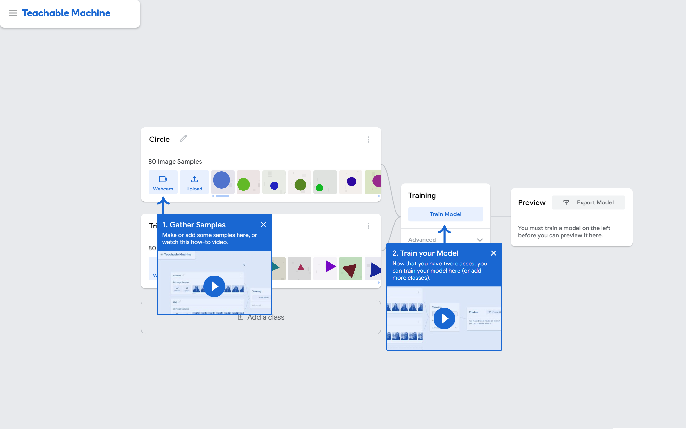
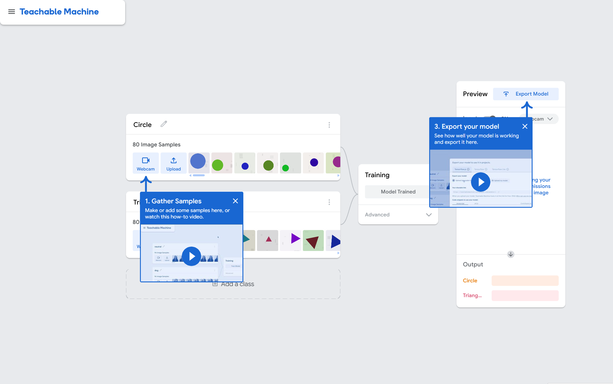
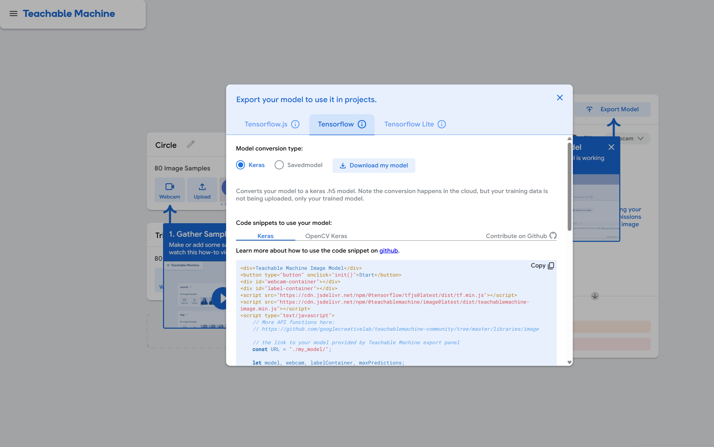
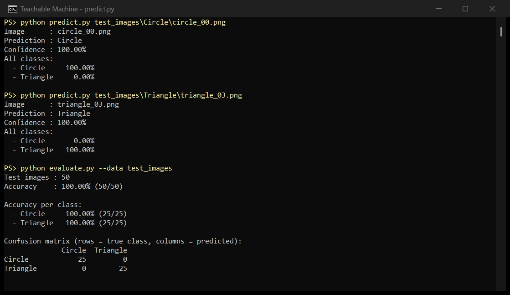

# تصنيف الصور باستخدام Teachable Machine و Python

مشروع الأسبوع الثالث: تدريب نموذج للتعرف على الصور باستخدام **Google Teachable Machine**، ثم تصديره بصيغة **TensorFlow → Keras**، وكتابة سكربت Python يحمّل النموذج ويتنبأ بفئة أي صورة.

النموذج يميّز بين فئتين:

| الفئة | الوصف |
|------|-------|
| `Circle` | صورة فيها دائرة |
| `Triangle` | صورة فيها مثلث |

**النتيجة:** دقة 100% على 50 صورة اختبار جديدة لم يرها النموذج أثناء التدريب.

---

## محتويات المستودع

```
teachable-machine-image-classifier/
├── model/
│   ├── keras_model.h5        # النموذج المُصدَّر من Teachable Machine
│   └── labels.txt            # أسماء الفئات (0 Circle, 1 Triangle)
├── predict.py                # السكربت الرئيسي: يحمّل النموذج ويتنبأ بفئة صورة
├── evaluate.py               # تقييم النموذج على مجلد صور (الدقة + مصفوفة الالتباس)
├── make_test_images.py       # توليد صور اختبار جديدة
├── test_images/              # 50 صورة اختبار (25 لكل فئة)
├── screenshots/              # لقطات الشاشة لكل الخطوات والنتائج
└── requirements.txt
```

---

## الخطوة 1: تجهيز البيانات (فئتين)

استخدمت فئتين: **Circle** و **Triangle**، ولكل فئة **80 صورة**.

الصور مرسومة بشكل عشوائي حتى يتعلم النموذج **الشكل** وليس اللون أو المكان:
- لون الشكل عشوائي
- حجم الشكل ومكانه عشوائيان
- المثلث يدور بزاوية عشوائية
- لون الخلفية عشوائي مع بقع خفيفة كتشويش

## الخطوة 2: تدريب النموذج في Teachable Machine

1. فتحت الموقع: https://teachablemachine.withgoogle.com ثم **Get Started** ← **Image Project** ← **Standard image model**.
2. سمّيت الفئة الأولى `Circle` والثانية `Triangle`.
3. رفعت صور كل فئة من زر **Upload**.



4. ضغطت **Train Model** بالإعدادات الافتراضية:
   - Epochs = 50
   - Batch Size = 16
   - Learning Rate = 0.001



## الخطوة 3: تصدير النموذج بصيغة Keras

1. ضغطت **Export Model**.
2. اخترت تبويب **Tensorflow** ثم **Keras**.
3. ضغطت **Download my model**، فنزل ملف `converted_keras.zip`.
4. فككت الضغط ووضعت الملفين `keras_model.h5` و `labels.txt` داخل مجلد `model/`.



## الخطوة 4: تجهيز بيئة Python

> **مهم (مشكلة توافق الإصدارات):** النموذج المُصدَّر من Teachable Machine لا يعمل مع TensorFlow الحديث (Keras 3)، ويظهر هذا الخطأ:
> `Unrecognized keyword arguments passed to DepthwiseConv2D: {'groups': 1}`
>
> الحل: استخدام **TensorFlow 2.12.1** مع Python من 3.8 إلى 3.11.

### الطريقة الأولى: Anaconda (كما في الشرح)

1. حمّل Anaconda من https://www.anaconda.com/download
2. من **Anaconda Navigator** ← **Environments** ← **Create**، أنشئ بيئة باسم `Teachable-Machine-tf212` واختر **Python 3.10**.
3. اضغط على البيئة ← **Open Terminal**، ثم ثبّت المكتبات:

```bash
pip install opencv-python
pip install tensorflow==2.12.1
pip install pillow numpy
```

### الطريقة الثانية: venv (التي استخدمتها)

```bash
py -3.9 -m venv .venv
.venv\Scripts\activate
pip install -r requirements.txt
```

## الخطوة 5: سكربت Python للتنبؤ (`predict.py`)

السكربت يقوم بالآتي:

1. **تحميل النموذج:** `load_model("model/keras_model.h5", compile=False)`
2. **قراءة أسماء الفئات** من `labels.txt`.
3. **تجهيز الصورة بنفس طريقة Teachable Machine:**
   - تحويلها إلى RGB
   - قصّها لتصبح مربعة وتغيير حجمها إلى 224×224
   - تحويل قيم البكسلات من المدى [0, 255] إلى [-1, 1] بالمعادلة `(x / 127.5) - 1`
4. **التنبؤ:** `model.predict` يُرجع احتمال كل فئة، ونأخذ الفئة صاحبة أعلى احتمال (`argmax`).
5. **طباعة النتيجة:** اسم الفئة ونسبة الثقة واحتمالات كل الفئات.

طريقة التشغيل:

```bash
python predict.py path/to/image.png
```

مثال:

```
Image      : circle_00.png
Prediction : Circle
Confidence : 100.00%
All classes:
  - Circle     100.00%
  - Triangle     0.00%
```

## الخطوة 6: تقييم النموذج

حتى أتأكد أن النموذج يعمل فعلًا على صور جديدة، ولم يحفظ صور التدريب فقط:

1. ولّدت **50 صورة جديدة** (25 لكل فئة) بسكربت `make_test_images.py`، بإعدادات عشوائية مختلفة عن صور التدريب.
2. شغّلت `evaluate.py`، وهو يحسب الدقة الكلية والدقة لكل فئة ومصفوفة الالتباس (Confusion Matrix).

```bash
python make_test_images.py --per-class 25
python evaluate.py --data test_images
```

النتائج:

| المقياس | القيمة |
|--------|--------|
| الدقة الكلية | 100% (50/50) |
| دقة Circle | 100% (25/25) |
| دقة Triangle | 100% (25/25) |

مصفوفة الالتباس:

|              | توقّع Circle | توقّع Triangle |
|--------------|:-----------:|:-------------:|
| **Circle**   | 25          | 0             |
| **Triangle** | 0           | 25            |

## الخطوة 7: لقطة شاشة للنتيجة



---

## الأدوات المستخدمة

- Google Teachable Machine
- Python 3.9
- TensorFlow 2.12.1 / Keras
- Pillow, NumPy
